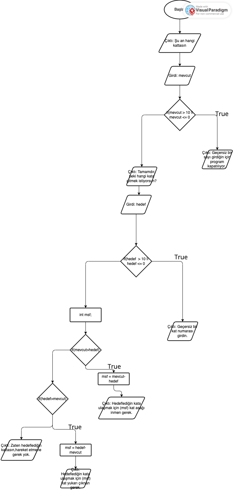

# Rapor

**Ad Soyad: Emir Ali Mayan**
**Numara: 740**

## 1. Problemin Açıklaması
<!-- Problemi kendi cümlelerinizle yazın. -->
Bu kodun problemi 10 katlı bir apartmanda asansörün hareket yönünü ve mesafesini söyleyen bir program yazmaktır.

## 2. Girdi - İşlem - Çıktı

**Girdiler:**
Kullanıcının olduğu kat, kullanıcının gitmek istediği kat.

**İşlemler:**
Kullanıcının olduğu kat ile arasındaki mesafeyi bulma, kullanıcının, istediği kata çıkması için hangi yöne gitmesi gerektiğini bulma, geçersiz kat girişini kontrol etme.

**Çıktılar:**
Kullanıcının gitmesi gereken yön (aşağı/yukarı), hedef kat ile mevcut kat arasındaki mesafe.

## 3. Sözde Kod (Pseudocode)
<!-- AI kullanarak Psuedocode'un ne demek olduğunu öğrendim, bu psuedocode'u onun verdiği örneği kullanarak kendim yazdım. -->
```
1. BAŞLA
2. Yazdır("Kat sayısı 10 olarak belirlendi.")
3. Kullanıcıdan şu an olduğu katı iste ve bunu "mevcut" değişkenine kaydet.
4. "mevcut" değişkeninin içindeki sayının geçerli olup olmadığını kontrol et. (Eğer 0'dan küçük veya 10'dan büyükse hata mesajı ile çıkış yap, değilse devam et.)
5. Ardından kullanıcıya gitmek istediği katı sor ve verdiği cevabı "hedef" değişkenine kaydet.
6. "hedef" değişkenine de "mevcut" değişkenine yaptığın kontrolun aynısını yap, yine aynı koşulları sağlıyorsa devam et veya çıkış yap.
7. Hedef ve mevcut değişkenlerini karşılaştır. Eğer mevcut değişkeni hedef'ten büyükse: msf = mevcut-hedef olarak ata ve (msf + " kadar aşağı in") diye yazdır.
8. Eğer hedef değişkeni mevcuttan büyükse: msf = hedef-mevcut olarak ata ve (msf + " kadar yukarı çık") diye yazdır.
9. Eğer 2 değişken de birbirine eşitse "Zaten hedefledigin kattasın, hareket etmene gerek yok" diye yazdır.
10. BİTİR

```

## 4. Akış Şeması



## 5. Test Sonuçları

| Mevcut kat | Hedef kat | Beklenen sonuç | Programın sonucu | Doğru mu? |
|---|---|---|---|---|
| 3 | 8 | 5 kat yukarı | Hedefledigin kata ulasmak icin 5 kat yukari cikman gerekiyor. | Doğru |
| 9 | 2 | 7 kat aşağı | Hedefledigin kata ulasmak icin 7 kat asagi inmen gerekiyor. | Doğru |
| 5 | 5 | Hareket yok | Zaten hedefledigin kattasin. Hareket etmene gerek yok. | Doğru|
| 1 | 10 | 9 kat yukarı |Hedefledigin kata ulasmak icin 9 kat yukari cikman gerekiyor. | Doğru |
| 10 | 1 | 9 kat aşağı |Hedefledigin kata ulasmak icin 9 kat asagi inmen gerekiyor. | Doğru |
| 0 | 5 | Geçersiz mevcut kat | Mevcut katini gecersiz girdin. Program kapatiliyor. | Doğru |
| 5 | 11 | Geçersiz hedef kat | Hedef katini gecersiz girdin. Program kapatiliyor. | Doğru |
| -2 | 4 | Geçersiz mevcut kat | Mevcut katini gecersiz girdin. Program kapatiliyor. | Doğru |

## 6. Ekstra Görev (Opsiyonel)
<!-- 3 -> 8 için geçilen katların çıktısını buraya yapıştırın. -->
